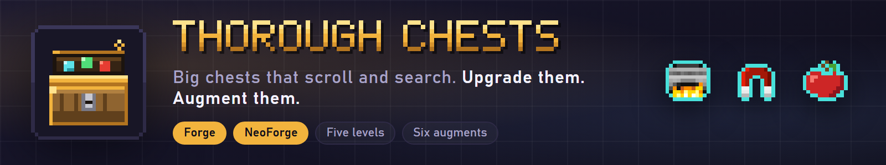
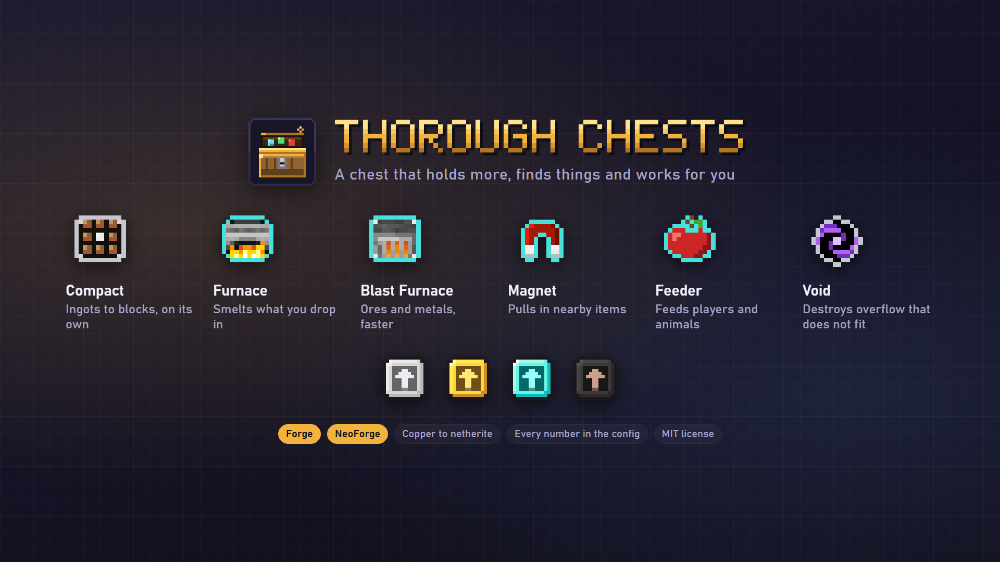
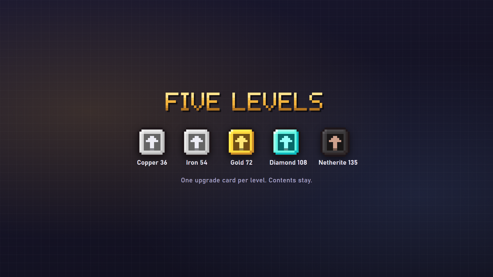
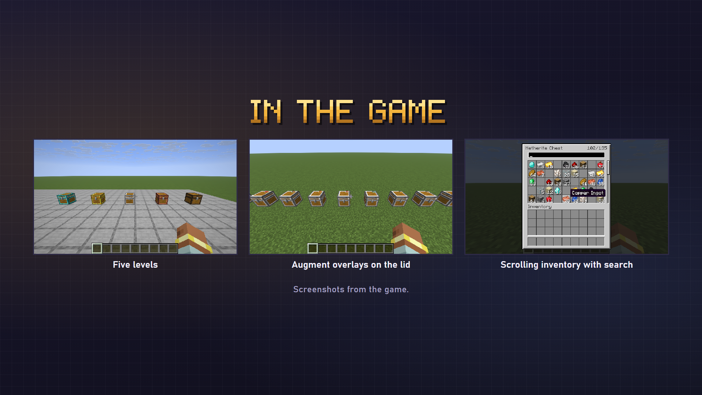

**Big chests that scroll and search, five levels from copper to netherite, and augments that compact, smelt, attract, feed and void items. For Forge and NeoForge.**

Thorough Chests adds a chest with its own big inventory. It is one block, never a double chest, with the vanilla lid animation and sounds. Open it and you get a scrolling window with a search bar that fits any screen size. Upgrade cards move a chest up a level and keep what is inside, and one augment per chest makes it work for you.

# Features

- **Five levels:** Copper 36 slots, Iron 54, Gold 72, Diamond 108 and Netherite 135 by default. Blast resistance rises with every level and Netherite is immune to explosions.
- **Upgrade cards:** one card moves a chest exactly one level, contents kept. Only the copper chest is crafted: a vanilla chest and eight copper ingots.
- **Chest screen:** scroll with the wheel or the scrollbar, search by name, `@mod` or `#tag`.
- **Compact augment:** crafts uniform 2x2 and 3x3 recipes down, so ingots become blocks.
- **Furnace and Blast Furnace augments, levels 1 to 3:** smelt what is in the chest while it holds fuel, and put the results back. Higher levels are faster and use less fuel.
- **Magnet augment, levels 1 to 3:** pulls item entities in from a growing radius.
- **Feeder augment, levels 1 to 3:** feeds hungry players and friendly animals from the chest's food.
- **Void augment:** destroys overflow that does not fit.
- **On the chest:** the installed augment is drawn as a small overlay on the lid.
- **Redstone and automation:** a comparator signal that spans the whole inventory, and hoppers and pipes that reach every slot.
- **Scripting:** ModJS scripts get a `ThoroughChests` global with events, chest reads, item rules and settings.

# Settings

Slot counts, blast resistance and every augment number (speed, fuel use, radius, range, cadence) are in `config/thoroughchests-common.toml`.

# Compatibility

- Recipe viewers show every recipe, including a Chest Upgrade and an Augment Upgrade category: BEI on Forge and NeoForge, JEI and REI on NeoForge.
- Show Me What This Is shows level, slots used, and the installed augment on Forge and NeoForge. Jade does the same on NeoForge.
- ModJS scripts on Forge and NeoForge. KubeJS can change every recipe through datapacks, and gets events through a bridge on NeoForge 26.1.2.
- EMI has no build for these Minecraft versions yet.
- Hoppers, pipes and other mods' item transfer see every slot of every chest.

# FAQ

**Does it need to be on the server?** Yes, on the server and on every client.

**Does it need another mod?** No. Recipe viewers, info overlays and script mods are optional.

**Can I change the numbers?** Yes, in the config file.

**How do I get the higher levels?** Only with upgrade cards. Craft the copper chest, then use a card on it.

**Fabric?** Not at this time.

**Can I use it in my modpack?** Yes. It is MIT licensed.

Made by ItMeCasey Studios. Source and issues on [GitHub](https://github.com/ItMeCasey/ThoroughChests).
